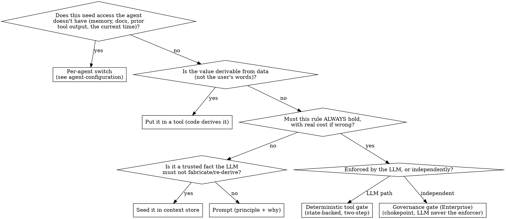

# Agent prompt design: where a behaviour lives

## Overview

Before you write a line of prompt, decide **where the behaviour belongs**. The prompt is one of five homes, and it is the *weakest* place to put anything that must hold. Putting a load-bearing rule in prose and then re-tightening it when the model ignores it is the single most common mistake, and the costliest.

**Core principle:** the LLM decides what is *soft, linguistic, and reversible*; **code** decides what is *hard, data-derived, or costly-if-wrong*. Match each behaviour to the home that matches its cost.

## The six homes

| Home | Owns | Reach for it when |
|---|---|---|
| **Per-agent switch** | access the agent doesn't have at all — memory, documents, prior tool output, the current time | the gap is *access*, not judgment; no prompt wording can grant it (see `agent-configuration`) |
| **Prompt** | routing, flow, tone, which tool to call, conversational judgment | the decision is reversible and cheap-if-wrong; the model has the context to judge it. If only a minority of conversations need it, it is prompt text that belongs in a **skill** — see `agent-skills` |
| **Tool (code)** | any value/decision derivable from data, not from the user's words | the correct answer is a function of state, not of phrasing (see `tool-design`) |
| **Deterministic tool gate** | a rule that MUST hold and the prompt keeps violating | prose failed *and* getting it wrong has real cost (compliance, data, money) |
| **Context store** | trusted identity + pre-resolved facts + cross-turn working state | you need a fact the LLM must not fabricate or re-derive |
| **Governance gate** (Enterprise) | hard policy enforced independently of the LLM | the rule must hold regardless of what the model does, and be auditable. On OSS, reach the same guarantee with deterministic code of your own, or the built-in opt-out handling |

## Decision flowchart

## The patterns, with evidence

### Derive from data, don't let the LLM choose (prompt → tool)
If the correct value is a function of state, the LLM must never pick it from the user's words. Exposing it as an LLM-chosen enum is a bug, not a feature.
- **Evidence:** an agent exposed a service-type choice to the model as an enum; a user's phrasing produced the wrong branch and the wrong downstream action. Fix: derive the value inside the tool from the record's own data, and remove the choice from the model. Eligibility for the action stayed as a gate **inside** the tool itself, so the model never sees the flag the decision rests on.

### LLM classifies, tool decides (the two-axis split)
When only the LLM can read the utterance but the *action* must be deterministic, split the two axes: the LLM passes a narrow classification (`basis`/enum); the tool decides what to do with it. Don't gate on a signal the LLM won't reliably send.
- **Evidence:** a user *asking* whether something is already done vs *committing* to it is a purely linguistic difference → the LLM sets a `basis` saying which one it heard; the tool records deterministically. The question basis is **not gated**, because asking is itself the engagement signal.

### Escalate prompt → deterministic gate ONLY after prose fails and cost is real
A rule stated in prose and ignored is not fixed by louder prose. But a gate is a heavier tool with a failure mode of its own (deadlock). Escalate only when both are true: (1) the prompt-only version measurably fails, (2) getting it wrong has real cost.
- **Evidence (escalate):** a prompt-only rule requiring the agent to collect an explicit answer before recording it was ignored **3/3** — the model recorded an answer the user never gave. Fix: a two-step state-backed gate (a first tool marks in state that the question was asked; a second records the answer only if that mark is present).
- **Evidence (do NOT gate):** an optional information request is *optional* — a gate would deadlock. It stayed in the prompt, fixed by separating the mandatory ACTION from the optional DATA (see below).
- **Gate caveat:** a two-step gate deadlocks if step-1 isn't enabled/reachable. Both tools must be among the agent's enabled tools; there must be a clear unblock path. Never gate an optional step.

### Trusted facts live in context store, not in an LLM argument
Identity (phone, chat id), pre-resolved lookups, and pre-resolved defaults are injected server-side and read from state — never trusted from an LLM-supplied argument (injection-resistant). Writes are deterministic tool-code only, **never** an LLM-facing `remember()`.
- **Evidence:** a channel can project trusted caller fields into conversation state via its field mapping, and a start-of-conversation hook can seed a derived fact from those fields — e.g. a known contact's default location, so they aren't asked for it again. In the prompt, *reference* the pre-seeded state — don't instruct the model to re-derive it.

### Governance gate: enforce independently of the LLM
When a rule must hold regardless of the model and be auditable, it belongs at a deterministic chokepoint where the LLM is never the enforcer. Configurable governance gates are an **Enterprise** surface; the principle applies on both editions.
- **Evidence:** the opt-out STOP/START handling, on both editions, is a keyword gate at inbound/outbound chokepoints; the keyword is injected into the prompt only as *informational context* — the LLM never enforces it.

### A remote tool's description is text a third party writes into your prompt

Equipping tools from an external MCP server (`plugin-authoring`, `tool-design`) has a
consequence worth stating in this skill, because it is the first time something other
than you writes into the agent's system prompt: **a remote tool's description is
rendered into the tool catalog verbatim**, and the tool catalog lives in the stable,
highest-trust, cached prefix — right beside the agent's own instructions.

The engine defends the mechanism, not the meaning. It wraps the remote text in an
explicit `untrusted_remote_description` tag so its provenance is visible to the
model, neutralises the delimiters that would let it close that tag, defangs the brace
pairs that the prompt assembler would otherwise re-expand as placeholders, and caps
the length so a server that flaps long descriptions cannot keep invalidating the
shared cache prefix. What it cannot do is decide whether the *content* is a
reasonable instruction.

So the design rule is the same one that governs an LLM-supplied argument, one level
up: **a remote description may inform the model, never authorise it**. Anything that
must hold regardless of what that text says belongs in a home the description cannot
reach — a tool you wrote, a deterministic gate, a governance gate. And prefer an
`allowList` on the server: a tool you never equip has no description to inject.

## Two prompt traps this decision prevents

- **Over-correction by negative guidance.** A strong, repeated prohibition ("don't insist / don't push for it") can round up to "skip the step entirely." Separate the **mandatory action** ("ask once, always") from the **optional data** ("accept a refusal — but only *after* asking"). Evidence: an agent skipped an optional information request outright because the anti-insistence rule overpowered the single "ask once" line.
- **No concrete examples in prompts.** Write rules at the level of *principle/category*, not specific instances in parentheses — a concrete example overfits the model to that case and ages badly. Exception: response *templates* the stakeholder explicitly wants (a fixed greeting formula) are intended output, not illustration.

## Common mistakes

| Mistake | Fix |
|---|---|
| "The model ignores this rule → tighten the prompt" | Measure it, then move the guarantee into a tool gate (`tool-design`) |
| LLM picks an enum whose value is derivable from data | Derive it in the tool; remove the choice |
| Gating an optional step | Deadlock. Keep it in the prompt; separate action from data |
| Trusting identity from an LLM argument | Read it from context store (`ctx.state.channel`) |
| Escalating to a gate without measuring first | Run boundary scenarios (`evaluating-agents`) — recurring false pos/neg is the signal, not a hunch |
| Concrete examples in the prompt | Principle/category, not instances |
| "The agent should remember/know X" written as a prompt rule | Check `agent-configuration` first — it may be a per-agent switch, not a prompt problem |

See also: `agent-prompt-writing` (how to phrase what stays in the prompt), `tool-design` (the `status` contract and decision-ownership), `evaluating-agents` (measure before escalating), `agent-configuration` (the sixth home — per-agent switches for access the agent doesn't have).
